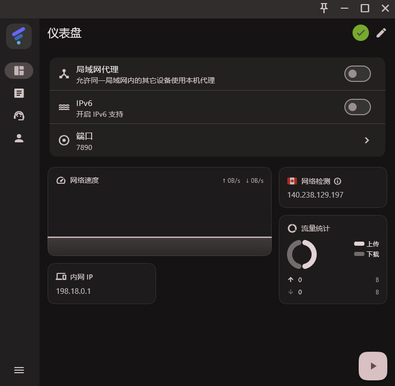
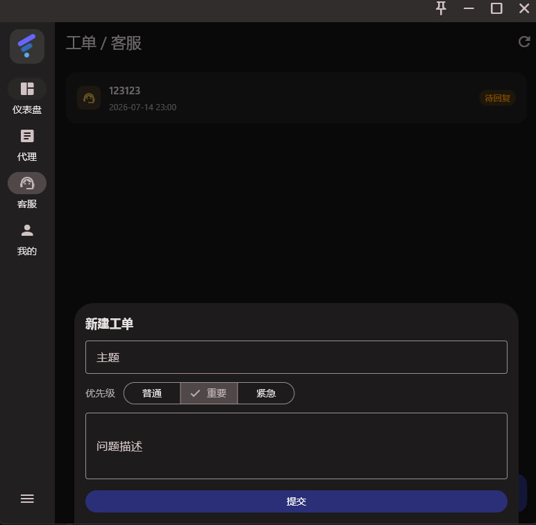
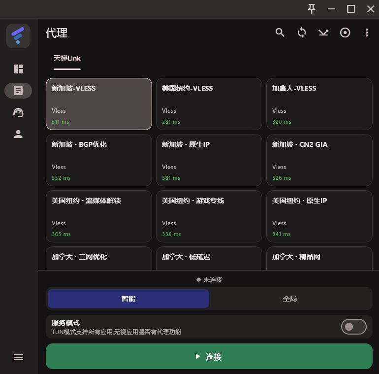
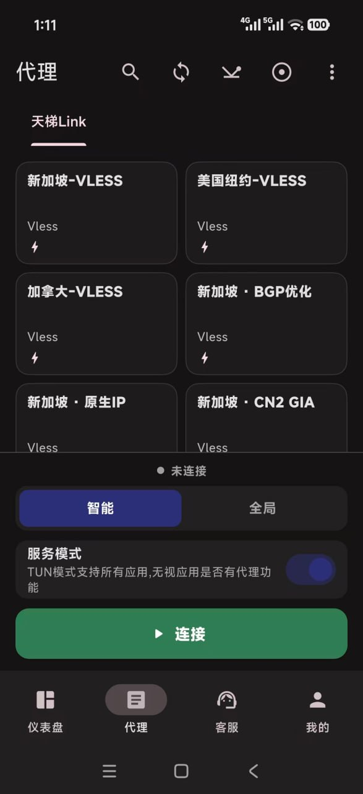

# TianTiLink 天梯

[**English**](README.md)

  

**高速 VPN · Clash 代理客户端 · 跨平台网络加速 · 一键订阅连接。**

TianTiLink 面向 Windows、Android 和 macOS，提供登录即同步节点、智能分流、全局代理与 TUN 模式。苹果手机和 iPad 可使用 **Clash Plus、sing-box MT、Hiddify** 一键导入订阅。

## 📥 下载

- 🌐 **官网直下(推荐)**:**https://tianticom.xyz** — Android / Windows / macOS 一键下载
- 📱 **iPhone / iPad**:打开 [iOS 一键订阅教程](https://tianticom.xyz/dl/ios-appstore-guide.html)，支持 **Clash Plus、sing-box MT、Hiddify**
- 📦 GitHub Releases:**https://github.com/TianTiLink/FlClash/releases**

## 🤝 推广赚钱

把 TianTiLink 分享给好友，他们注册购买后可按后台代理比例获得推广收益。使用交流、节点帮助和活动信息请加入 TG 群 [@TianTivpn8](https://t.me/TianTivpn8)。

## 💻 预览

**桌面端**

  
  
  

**移动端**

## ✨ 特性

- ✈️ Windows / Android / macOS 客户端，一键登录、同步节点与智能连接
- 🍎 iPhone / iPad 支持 Clash Plus、sing-box MT、Hiddify 一键订阅
- 🚀 基于 Mihomo / ClashMeta 内核，支持智能分流、全局代理与 TUN 模式
- 🔄 多订阅入口自动容错，支持节点刷新、延迟检测与低连接数优先排序
- 🔒 订阅安全保护、加密传输、简洁无广告界面

## 🔎 搜索关键词

VPN 客户端、Clash 客户端、Mihomo、ClashMeta、sing-box、Hiddify、iOS VPN、Clash Plus、Windows VPN、Android VPN、macOS VPN、科学上网、梯子、节点订阅、一键订阅、网络加速器。

## ⭐ Star

觉得好用,点页面顶部的星标(⭐)支持一下。

    

---

本项目基于开源项目 [FlClash](https://github.com/chen08209/FlClash)(ClashMeta GUI 客户端)二次开发,遵循 [GPL-3.0](LICENSE) 协议开源。
